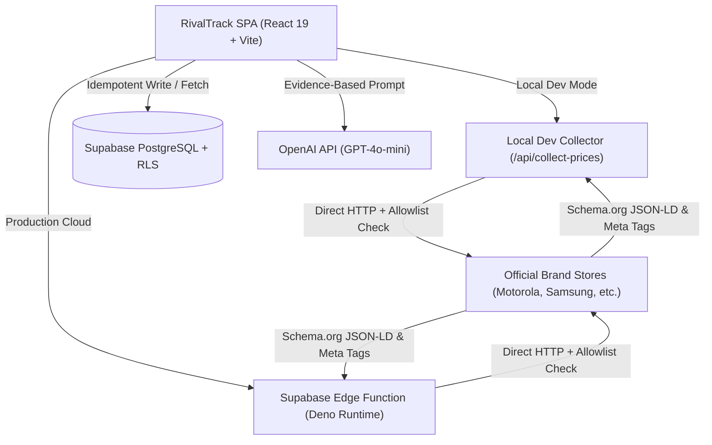

# RivalTrack ⚡

> **Enterprise-grade competitive intelligence platform for smartphones and consumer electronics.** Track real competitor prices, promotional offers, marketing campaigns, and generate grounded AI-powered strategic recommendations.

[](https://www.typescriptlang.org/)
[](https://react.dev/)
[](https://vite.dev/)
[](https://supabase.com/)
[](#)

---

## 📌 Table of Contents

- [Overview](#-overview)
- [System Architecture](#-system-architecture)
- [Tech Stack](#-tech-stack)
- [Feature Status](#-feature-status)
  - [✅ Fully Implemented](#-fully-implemented)
  - [⏳ Pending & Roadmap](#-pending--roadmap)
- [Project Directory Structure](#-project-directory-structure)
- [Getting Started](#-getting-started)
  - [Prerequisites](#prerequisites)
  - [Installation & Setup](#installation--setup)
  - [Supabase Database Configuration](#supabase-database-configuration)
  - [Environment Variables](#environment-variables)
  - [Running the Application](#running-the-application)
- [Edge Functions & Data Collection Engine](#-edge-functions--data-collection-engine)
- [Running Tests](#-running-tests)
- [Ethical Scraping & Security Guidelines](#-ethical-scraping--security-guidelines)
- [Contributing & License](#-contributing--license)

---

## 🚀 Overview

**RivalTrack** is designed for product strategists, pricing analysts, and marketing leaders in the competitive consumer electronics and smartphone landscape. 

Traditional market intelligence relies on delayed periodic analyst reports or brittle web scrapers. RivalTrack provides a modern solution:
1. **Live, Verified Price Tracking**: Scrapes live brand store pages (e.g., Motorola, Samsung, Apple) extracting official Schema.org JSON-LD and OpenGraph metadata.
2. **Honest Data Philosophy**: Strictly avoids fabricating synthetic or fake prices when sources are unreachable, reporting 404/429/timeout statuses transparently.
3. **Deterministic Deduplication**: Employs an hourly-bucket unique constraint index to prevent redundant database writes and false change events.
4. **Evidence-Grounded AI Insights**: Synthesizes verified price drops and campaign launches into actionable executive counter-strategies using LLMs (OpenAI GPT-4o-mini).

---

## 🏗 System Architecture



---

## 💻 Tech Stack

### Frontend & UI
- **Framework**: [React 19](https://react.dev/)
- **Language**: [TypeScript](https://www.typescriptlang.org/) (strict mode)
- **Bundler & Tooling**: [Vite 8.3](https://vite.dev/) with Fast Refresh & HMR
- **Routing**: [React Router v7](https://reactrouter.com/)
- **Icons**: [Lucide React](https://lucide.dev/)
- **Styling**: Handcrafted responsive CSS design system with custom CSS variables, glassmorphism, dynamic telemetry indicators, and high-contrast dark theme

### Backend, Database & Edge Computing
- **Database**: [Supabase](https://supabase.com/) (PostgreSQL 15+)
- **Security**: Row Level Security (RLS) policies on all tables
- **Edge Computing**: Supabase Edge Functions (Deno TypeScript runtime)
- **Dev Server Proxy**: Vite internal middleware to eliminate browser CORS obstacles during local development

### Intelligence & Parsing
- **Data Ingestion**: Schema.org JSON-LD parser + OpenGraph meta tag extractor
- **AI Synthesis**: OpenAI GPT-4o-mini integration with template fallback engine

---

## 📊 Feature Status

### ✅ Fully Implemented

- [x] **Executive Dashboard**: Real-time KPI summary cards (Monitored Competitors, Tracked Products, Active Promotions, Critical Price Alerts) and real-time live telemetry stream.
- [x] **Competitor Monitoring**: Detailed competitor brand registry (Samsung, Apple, OnePlus, Motorola, Xiaomi, Vivo) with market share metrics and dynamic primary reference company switcher.
- [x] **Product Comparison Matrix**: Side-by-side spec comparisons across key smartphone attributes (Processor/SoC, RAM & Storage, Camera configuration, Battery capacity) and current store prices formatted in Indian Rupees (INR ₹).
- [x] **Promotions & Offers Tracker**: Real-time log of instant cashback, exchange bonuses, bundle deals, and seasonal discounts with active/expiring status tags.
- [x] **Campaign & Ad Intel**: Tracking competitor advertising creatives, platform distribution (Meta, Google Ads, YouTube, X), core messaging hooks, and estimated spend tiers.
- [x] **Audited Change Log**: Immutable chronological timeline recording price movements, offer launches, and spec changes with timestamped evidence links.
- [x] **AI Strategic Insights**: Context-aware recommendations classifying strategic threats (Pricing Pressure, Spec Advantage, Promotional Threat) with urgency ratings and actionable counter-moves.
- [x] **Real-World Live Web Collector**: Tested and verified live ingestion against official stores (e.g. Motorola India JSON-LD schema) with error handling for 404s and timeouts.
- [x] **Deduplication Engine**: Unique hourly-bucket database index (`uix_obs_product_hour`) preventing database bloat and false duplicate change events.
- [x] **Local Development Proxy**: Seamless CORS-free local testing via Vite custom server middleware in `vite.config.ts`.
- [x] **Health Check & Configuration Diagnostics**: Settings page with automated Supabase connection probe, schema verification, and API key format validators.

### ⏳ Pending & Roadmap

- [ ] **Multi-Tenant User Authentication**: Full Supabase Auth (OAuth / Email magic links) with organization-level access controls and custom user roles.
- [ ] **Automated Cron Scheduling**: Unattended periodic price collection using `pg_cron` or GitHub Actions workflows calling Edge Functions.
- [ ] **Marketplace Adapters**: Scraping connectors for multi-brand e-commerce platforms (Amazon.in, Flipkart, Croma, Reliance Digital) with proxy rotation.
- [ ] **Multi-Currency Support**: Dynamic currency switching (USD, EUR, GBP) alongside native Indian Rupee (INR ₹) formatting.
- [ ] **Notification Dispatchers**: Instant alerts via Webhooks, Slack channels, and automated email digests for high-urgency competitor price reductions.
- [ ] **Historical Price Trend Charts**: Interactive time-series visual charts using Chart.js or Recharts to visualize price trajectories over time.

---

## 📁 Project Directory Structure

```text
RivalTrack/
├── public/                      # Static assets and icons
│   ├── favicon.svg
│   └── icons.svg
├── src/
│   ├── assets/                  # Brand graphics and images
│   ├── components/
│   │   └── common/              # AppLayout, Navbar, Footer
│   ├── context/
│   │   └── AppContext.tsx       # Global application state, live telemetry & collectors
│   ├── data/
│   │   └── mockData.ts          # Baseline enterprise reference data
│   ├── lib/
│   │   └── supabase.ts          # Supabase client instantiation & connectivity probes
│   ├── pages/                   # Application views
│   │   ├── AlertsPage.tsx       # Notifications and critical alert triage
│   │   ├── CampaignsPage.tsx    # Advertising and marketing intelligence
│   │   ├── ChangelogPage.tsx    # Historical audit log of detected changes
│   │   ├── CompetitorsPage.tsx  # Competitor directory and market shares
│   │   ├── DashboardPage.tsx    # Executive dashboard & live telemetry
│   │   ├── InsightsPage.tsx     # AI-generated competitive strategy recommendations
│   │   ├── LandingPage.tsx      # Public landing page
│   │   ├── LoginPage.tsx        # Authentication view
│   │   ├── PricingOffersPage.tsx# Offers, discounts, and pricing monitor
│   │   ├── ProductsPage.tsx     # Product comparison matrix
│   │   ├── SelectCompanyPage.tsx# Onboarding reference company selector
│   │   └── SettingsPage.tsx     # System configuration, Supabase health checks
│   ├── server/
│   │   └── collectorHandler.ts  # Dev server collector implementation
│   ├── services/
│   │   ├── aiService.ts         # OpenAI integration and evidence-based synthesis
│   │   ├── collector.ts         # Client collector interface & HTTP dispatcher
│   │   └── db.ts                # Persistence engine, deduplication, and Supabase sync
│   ├── tests/                   # Verification and test suites
│   │   ├── dedup.test.ts        # Deduplication & change detection unit tests
│   │   ├── live_supabase.test.ts# Supabase database connectivity check
│   │   ├── real_collection.test.ts # End-to-end live store collection test
│   │   └── test_parser.ts       # HTML & JSON-LD parser validation
│   ├── types/
│   │   └── index.ts             # Domain TypeScript interfaces and helper functions
│   ├── App.tsx                  # Root router configuration
│   ├── index.css                # Global styles, variables, typography, and dark theme
│   └── main.tsx                 # Application entry point
├── supabase/
│   ├── functions/
│   │   └── collect-prices/      # Supabase Edge Function (Deno) for live store scraping
│   │       └── index.ts
│   └── migration.sql            # Table migration definitions
├── schema.sql                   # Complete non-destructive SQL schema with RLS & indexes
├── vite.config.ts               # Vite configuration with collector middleware plugin
├── tsconfig.json                # TypeScript project configuration
├── .env.example                 # Safe environment configuration template
└── README.md                    # Project documentation
```

---

## 🛠 Getting Started

### Prerequisites

- **Node.js**: `v18.0.0` or higher (Node.js 20+ LTS recommended)
- **Package Manager**: `npm` (v9+) or `pnpm` / `yarn`
- **Supabase Account**: Free or Pro tier at [supabase.com](https://supabase.com/)

### Installation & Setup

1. **Clone the repository:**
   ```bash
   git clone https://github.com/your-username/rivaltrack.git
   cd rivaltrack
   ```

2. **Install project dependencies:**
   ```bash
   npm install
   ```

3. **Configure environment variables:**
   ```bash
   cp .env.example .env
   ```
   Open `.env` and fill in your Supabase project credentials.

---

### Supabase Database Configuration

1. Log in to your [Supabase Dashboard](https://app.supabase.com/) and open your project.
2. Navigate to the **SQL Editor** tab from the left sidebar.
3. Open the [`schema.sql`](./schema.sql) file from this repository, copy its contents, paste them into the SQL Editor, and click **Run**.
4. The script safely applies:
   - 8 structured tables (`companies`, `products`, `price_observations`, `offers`, `campaigns`, `change_events`, `ai_insights`, `collection_jobs`)
   - Unique hourly deduplication index `uix_obs_product_hour` on `price_observations`
   - Row Level Security (RLS) policies and read/write grants for application roles

---

### Environment Variables

| Variable | Required | Default / Example | Purpose |
|---|---|---|---|
| `VITE_SUPABASE_URL` | Yes | `https://xyz.supabase.co` | Your Supabase project REST API endpoint |
| `VITE_SUPABASE_ANON_KEY` | Yes | `sb_publishable_...` | Supabase anonymous / publishable public key |
| `VITE_EDGE_COLLECT_URL` | Yes | `/api/collect-prices` | Endpoint for the server-side price collector |
| `VITE_OPENAI_API_KEY` | Optional | `sk-...` | Optional API key for live OpenAI LLM synthesis |

> ⚠️ **Note**: During local development with `npm run dev`, keep `VITE_EDGE_COLLECT_URL=/api/collect-prices`. Vite's dev server middleware will handle the scraping requests without browser CORS errors. When deploying to production on Vercel/Netlify, deploy the Supabase Edge Function and update this URL to your cloud function endpoint (`https://xyz.supabase.co/functions/v1/collect-prices`).

---

### Running the Application

Start the local development server:

```bash
npm run dev
```

Visit [`http://localhost:5173`](http://localhost:5173) in your browser.

To create an optimized production build:

```bash
npm run build
```

To preview the production build locally:

```bash
npm run preview
```

---

## ⚡ Edge Functions & Data Collection Engine

### Local Development Mode
In local development, modern web browsers enforce strict Cross-Origin Resource Sharing (CORS) rules that block client-side JavaScript from directly fetching external retailer web pages. 

RivalTrack solves this via an embedded Vite server plugin (`collectPricesDevPlugin` in `vite.config.ts`) which intercepts requests to `/api/collect-prices` and executes `handleCollectPrices()` on the Node.js server level.

### Supabase Edge Functions (Production)
For production deployments, deploy the provided Deno Edge Function located in `supabase/functions/collect-prices/`:

```bash
# Link your local project to Supabase
npx supabase link --project-ref your-project-ref

# Deploy the collector function
npx supabase functions deploy collect-prices --no-verify-jwt
```

---

## 🧪 Running Tests

RivalTrack includes dedicated test scripts covering parsing, live scraping, Supabase integration, and deduplication logic:

### 1. Deduplication & Change Detection Tests (In-Memory)
Tests unique-index deduplication, idempotent retries, price change delta calculations, and timeout safety:
```bash
npx tsx src/tests/dedup.test.ts
```

### 2. Live Store Parser Test
Tests extraction of Schema.org JSON-LD product data against official web pages:
```bash
npx tsx src/tests/test_parser.ts
```

### 3. End-to-End Real Collection & Supabase Test
Executes a live collection run against official store pages, verifies JSON-LD parsing, saves records to your configured Supabase database, and validates idempotency:
```bash
npx tsx src/tests/real_collection.test.ts
```

---

## 🛡 Ethical Scraping & Security Guidelines

RivalTrack follows responsible, ethical web data collection practices:
- **Allowlisted Targets Only**: Requests are restricted to explicitly configured official domains (`ALLOWED_DOMAINS` in `collectorHandler.ts` and `supabase/functions/collect-prices/index.ts`).
- **Public Data Exclusively**: Only unauthenticated, public store pages are fetched. No login forms, internal portals, or private APIs are queried.
- **Request Timeouts**: Strict 10-second request timeouts prevent hanging connections or undue load on target servers.
- **Transparent Failure Handling**: If an e-commerce page returns HTTP 404, 429 (Rate Limit), or 503, the collector records the event honestly without attempting anti-bot circumvention or forging synthetic prices.
- **Credential Hygiene**: Never commit your real `.env` file to version control. The `.gitignore` is strictly configured to protect secrets.

---

## 📄 Contributing & License

Private and proprietary. Developed for competitive market intelligence and pricing analysis.
